# ChessVault user guide

ChessVault keeps your chess games in databases, lets you replay and annotate them, and helps you
analyse them with a chess engine and the Lichess opening explorer. This guide shows each part with
screenshots and short videos. The videos show every click with a label and a chapter title for
each step; click a video link to play it.

The games in the pictures are made-up examples.

- [Start screen and databases](#start-screen-and-databases)
- [Opening ChessBase databases](#opening-chessbase-databases)
- [The game list](#the-game-list)
- [Replaying a game](#replaying-a-game)
- [Entering moves and variations](#entering-moves-and-variations)
- [Comments and symbols](#comments-and-symbols)
- [Saving games](#saving-games)
- [Searching for games](#searching-for-games)
- [Importing and exporting PGN](#importing-and-exporting-pgn)
- [Engine analysis](#engine-analysis)
- [Lichess opening explorer](#lichess-opening-explorer)
- [Keys](#keys)
- [Where your games are kept](#where-your-games-are-kept)
- [Problems](#problems)

## Start screen and databases

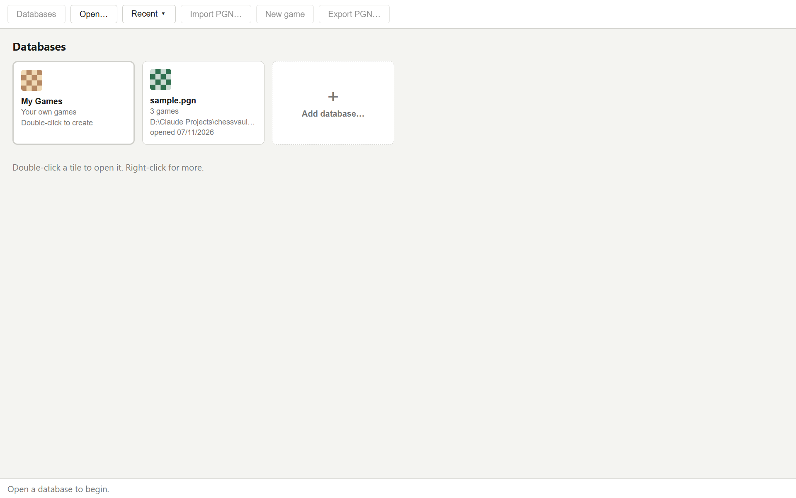

When ChessVault starts it shows your databases as tiles: the name, how many games it holds, its
folder and when you last opened it.

- **Double-click a tile** to open it (or click it once and press Enter).
- **My Games** is always first: a database for your own games. The first time you double-click
  it, ChessVault asks where to keep it.
- **Add database…** opens a PGN file (`.pgn`), a ChessVault database (`.sqlite`) or a ChessBase
  database (`.cbh` or `.cbv`) from any folder.
  **Open…** in the toolbar does the same, and **Recent ▾** lists the last files you opened.
- **Right-click a tile** to open it, show it in its folder, or remove it from the list. Removing
  only takes it off the list; the file stays on your disk.
- A tile that says **not found** points to a file that was moved or deleted.
- **Databases** in the toolbar brings you back to this screen from an open database.

▶ [Video: open a database and browse a game](videos/open-and-browse.webm)

## Opening ChessBase databases

ChessVault opens ChessBase databases (`.cbh`) and archives (`.cbv`) like any other file: choose them
with **Add database…** or **Open…**. The first time, it copies the games into a ChessVault database
in the same folder, named after the file (`Club.cbh` gets `Club.cbh.sqlite`):

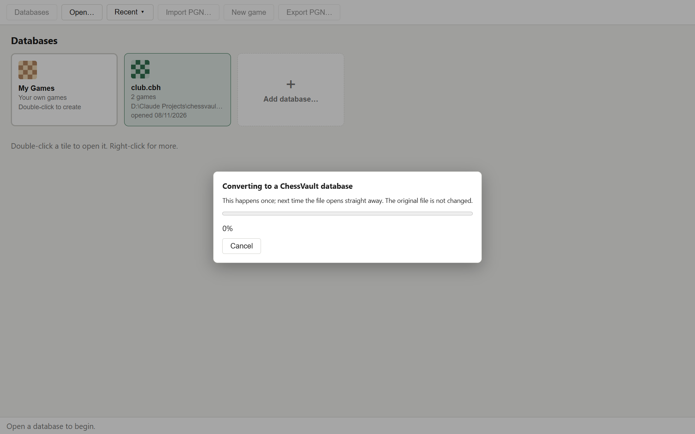

- **Your ChessBase files are never changed.** Edits and new games go into the ChessVault database.
- This happens once; afterwards the file opens straight away, even if you later move or delete the
  original. **Cancel** stops it and leaves nothing behind, and you can start again later. While an
  archive is unpacked or the database is finishing, stopping has to wait until that step is done.
- A very large database takes a while and makes a large file: about 6 minutes and 5.8 GB for 6.4
  million games. ChessVault tells you before it starts. If the folder is synced to a cloud service
  such as OneDrive, that file is uploaded too, so you may want to copy the database to another
  folder first. An archive also needs room for its unpacked files during the conversion.
- A damaged game is left out, and so are games with a null move (`--`) or a Chess960 start, which
  ChessVault can't show yet. The status bar says how many were left out whenever you open the file:
  in a test with 6.4 million games that was 563.
- Games you add in ChessBase later don't appear by themselves. To bring them in, delete the
  `.cbh.sqlite` file and open the database again; this also throws away changes made in ChessVault.
- ChessVault can't open password-protected archives or the newer `.2cbh` databases.

## The game list

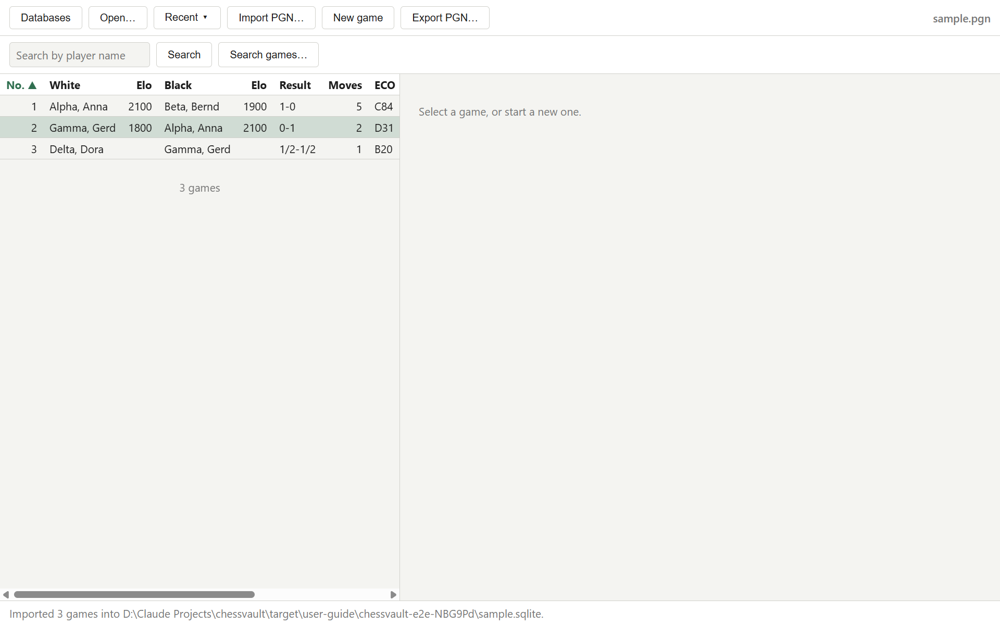

An open database lists its games with the number, both players and their Elo, the result, the
number of moves, the ECO opening code, event, site, round and date.

- **Click a column header** to sort by it, and click it again to reverse the order. Games without
  a value, such as an unrated player, are always listed last.
- **Scroll down** to load more games; large databases load 200 games at a time. In a database of
  millions of games, sorting by a column other than the number and searching take a long time.
- **Right-click a game** to open or delete it.

## Replaying a game

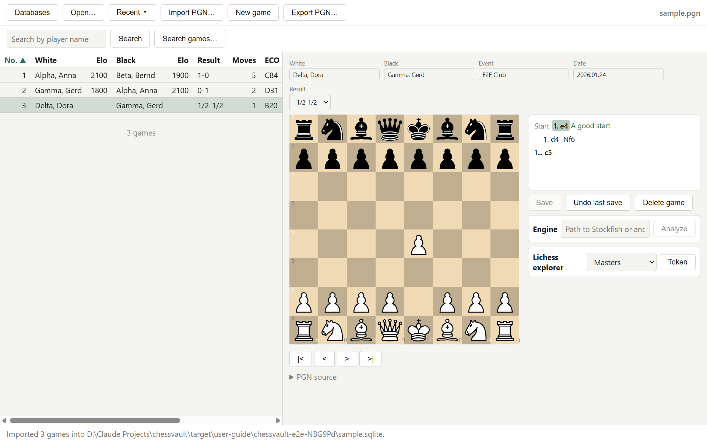

Click a game to show it. Above the board are the players, event, date and result; you can change
them right there. Next to the board is the notation: the main line in bold, variations in their
own lines or in brackets, and comments in green.

- **Click any move** in the notation to see the position after it.
- Use the **arrow keys** or the buttons below the board: `|<` start, `<` back, `>` forward,
  `>|` end of the line.
- **⇅** below the board, or the **F** key, turns the board round to see it from Black's side. It
  stays that way for other games until you turn it back.

## Entering moves and variations

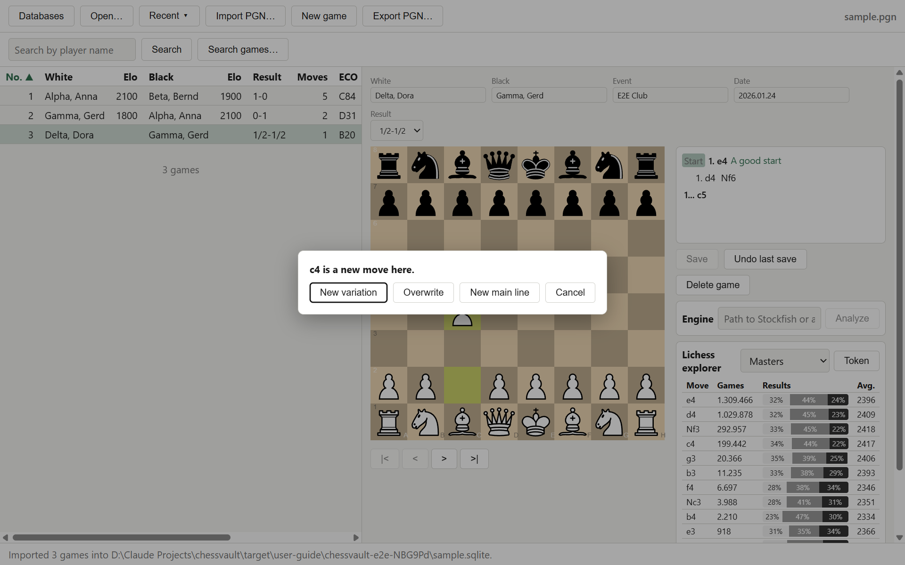

Play moves on the board by dragging or clicking a piece; only legal moves are possible. When a
pawn reaches the last rank, ChessVault asks which piece it becomes.

If you play a move where the game already continues differently, ChessVault asks what to do:

- **New variation** keeps the game as it is and adds your move as a side line.
- **Overwrite** replaces the game's continuation from here with your move.
- **New main line** makes your move the main line and keeps the old moves as a variation.
- **Cancel** puts the piece back.

Playing the move that is already there simply steps forward.

▶ [Video: enter a variation, comment it and save](videos/enter-variation.webm)

## Comments and symbols

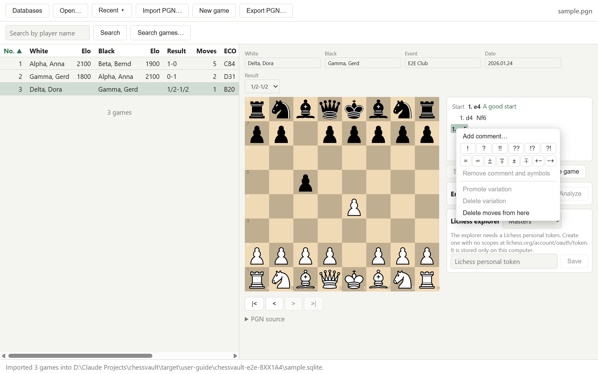

Right-click a move in the notation for:

- **Add comment… / Edit comment…** – text shown after the move.
- **Move symbols** `!` `?` `!!` `??` `!?` `?!` and **position symbols** `=` `∞` `⩲` `⩱` `±` `∓` `+−` `−+`.
  Click a symbol again to remove it.
- **Remove comment and symbols**.
- **Promote variation** – moves a variation one place up, up to the main line.
- **Delete variation** – removes the whole side line the move is in.
- **Delete moves from here** – removes this move and everything after it.

## Saving games

Changes show **Unsaved changes** next to the buttons. ChessVault asks before anything throws them
away: opening another game or database, a new game, **Undo last save**, or closing the window.

- **Save** stores the game in its database. **Undo last save** brings back the version from before
  the last save; you can undo several saves in a row.
- **New game** starts an empty board. **Save as new game** asks for the players, event, date and
  result, and where to save it:

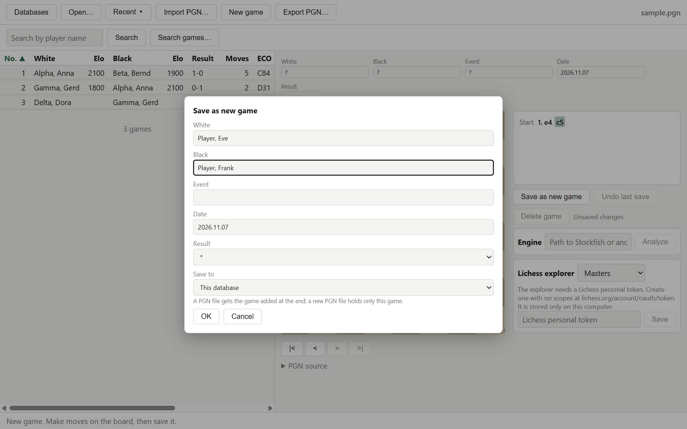

- **This database** – the database that is open.
- **An existing PGN file or database…** – the game is added at the end of that file.
- **A new PGN file or database…** – a new file; a new PGN file holds only this game. If you pick a
  PGN file that already exists, Windows asks whether to replace it, and it then holds only this game.
  An existing database is never replaced: add the game to it with the option above instead.

The game list updates at once, and the board stays on the move you were looking at.

- **Delete game** removes the game shown on the board, after asking. A deleted game can't be undone,
  so export your games first if you want a copy.

▶ [Video: enter and save a new game](videos/new-game.webm)

## Searching for games

Type a player's name in **Search by player name** and press Enter to find their games with either
colour. **Search games…** searches by more:

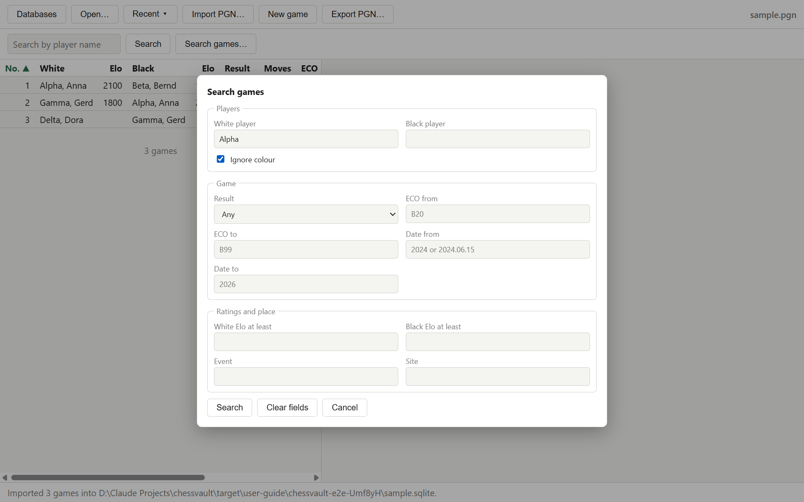

- **Players** – White and Black; tick **Ignore colour** to also find the games where the two played
  the other colours.
- **Result**, **ECO from / to** (for example `B20` to `B99`, or `C` to `D9` for all C and D codes),
  **Date from / to** (a year like `2024`, a month `2024.06` or a day `2024.06.15`).
- **White Elo at least**, **Black Elo at least**, **Event** and **Site**.

Names and text match any part and ignore upper and lower case. Every filled-in field must match.

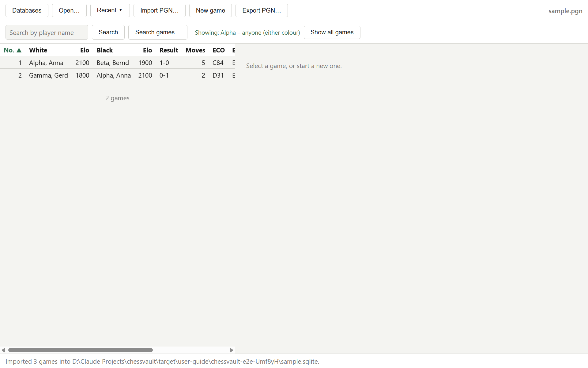

The line above the list shows what you searched for; **Show all games** brings back the full list.
The search window remembers your last search; **Clear fields** empties it.

▶ [Video: search for games](videos/search.webm)

## Importing and exporting PGN

- **Import PGN…** adds the games of a PGN file to the open database.
- **Export PGN…** writes all games, or only the game on the board, to a PGN file. ChessBase and most
  other chess programs open PGN files, so this is how you take your games elsewhere. An export
  contains the last saved version of each game.

## Engine analysis

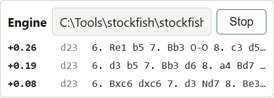

ChessVault works with Stockfish or any other UCI engine. Stockfish is free from
[stockfishchess.org](https://stockfishchess.org/download/).

1. Type the path of the engine program in the **Engine** panel, for example
   `C:\Tools\stockfish\stockfish-windows-x86-64.exe`. ChessVault remembers it.
2. Click **Analyze**. The engine shows its three best lines with the score from White's side
   (`+0.32` is a third of a pawn better for White, `#3` is mate in three) and the search depth.
3. The analysis follows the board as you move through the game. Click **Stop** to end it.

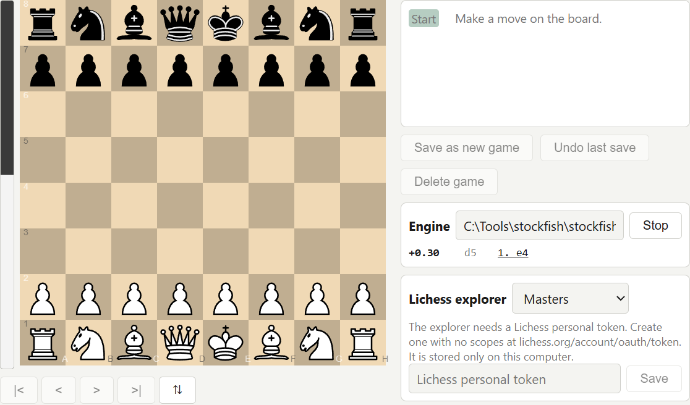

- The **bar beside the board** shows the engine's opinion at a glance: the more of it is white,
  the better White stands. Half and half is equal; a mate fills it completely. It turns with the
  board.
- **Click a move in an engine line** to play the line up to that move. Where the game already goes
  on differently, ChessVault asks as for a move on the board: new variation, overwrite or new main
  line.

## Lichess opening explorer

The **Lichess explorer** panel shows how often each move was played in the position and how those
games ended: White wins, draws and Black wins as a bar, with the average rating.

- Choose **Masters** (over-the-board games of strong players) or **Lichess games** (rated online
  games at blitz speed and slower, players rated 1800 and up).
- **Click a move** in the table to play it on the board.
- Lichess needs a personal token for the explorer. Create one with no permissions at
  lichess.org/account/oauth/token and paste it into the panel. It is stored only on your computer;
  **Token** lets you change or remove it.

## Keys

| Key | Does |
|---|---|
| → | Next move |
| ← | Previous move |
| Home | Start of the game |
| End | End of the current line |
| F | Turn the board round |
| Delete | Delete the shown move and everything after it (not saved until you save) |
| Ctrl+S | Save the game, also while typing in a field |
| Enter | Open the selected database tile; answer a comment |
| Shift+Enter | New line in a comment |
| Escape | Close a question, menu or the search window |

## Where your games are kept

- Opening a **PGN file** the first time creates a ChessVault database next to it with the same
  name, ending in `.sqlite` (for example `Club games.pgn` gets `Club games.sqlite`). Your edits and
  new games go into that database, and **editing never changes the PGN file**. Opening the PGN file
  again uses the same database, even if you deleted all its games. The PGN file only changes when
  you choose it under **Save as new game → An existing PGN file…**, which adds the game at its end.
- **ChessVault databases** (`.sqlite`) are single files you can copy or back up like any other.
- **ChessBase databases and archives** get a ChessVault database next to them too, named after
  the whole file (`Club.cbh.sqlite`). ChessVault never writes to ChessBase files.

## Problems

- **"is not a ChessVault database"** – the file is not a database ChessVault made, or a kind of file
  ChessVault can't read, such as a `.2cbh` database.
- **"could not read …"** – a ChessBase database is damaged or some of its files are missing. Keep all
  files of the database together in one folder.
- **"could not make a database beside …"** – ChessVault can't write in that folder. Copy the
  database's files to a folder of your own and open them there.
- **A recent file can't be opened** – it was moved or deleted. ChessVault offers to take it off
  the list; it never creates an empty database in its place. If My Games was moved, right-click it
  and choose **Choose another My Games database…**.
- **"could not start the engine"** – check the engine path in the Engine panel.
- **"Lichess rejected the token"** – the token was deleted or mistyped; create a new one.
- **"Lichess is limiting requests"** – wait a minute; stepping through many moves very fast can
  hit Lichess's limit.
